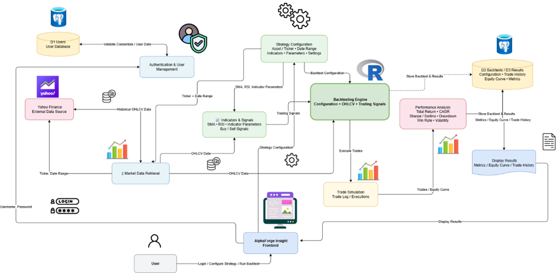
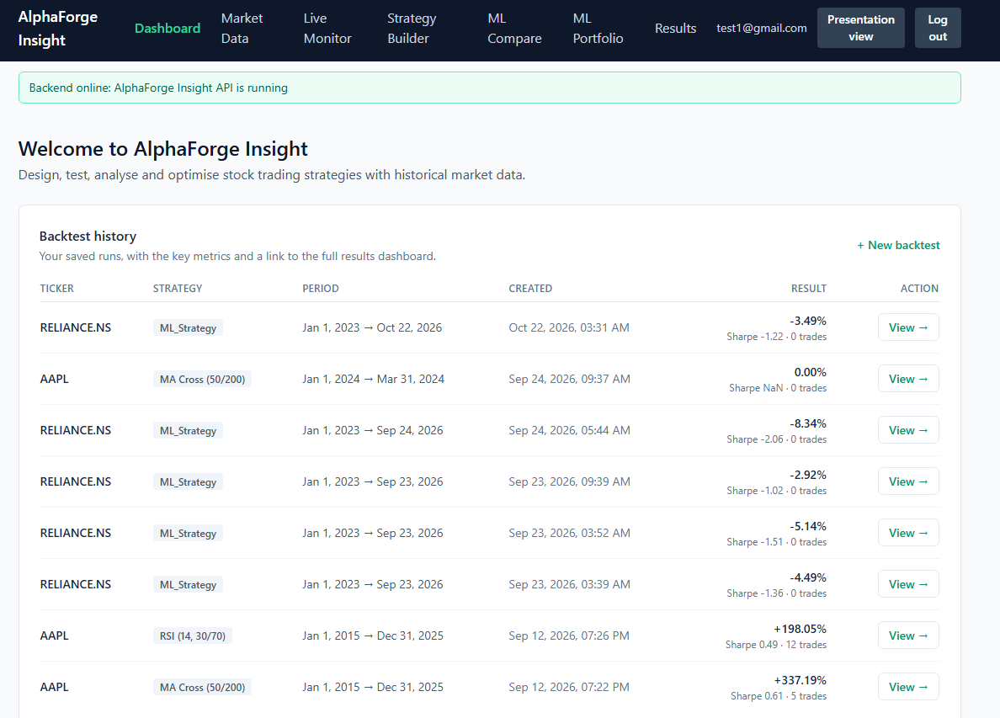
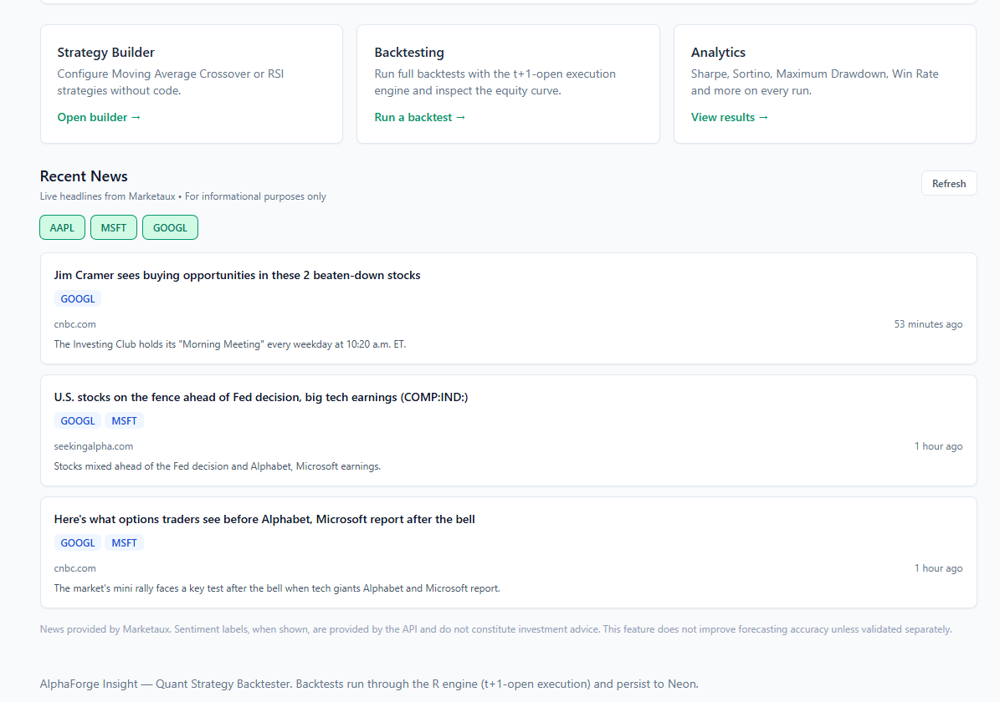
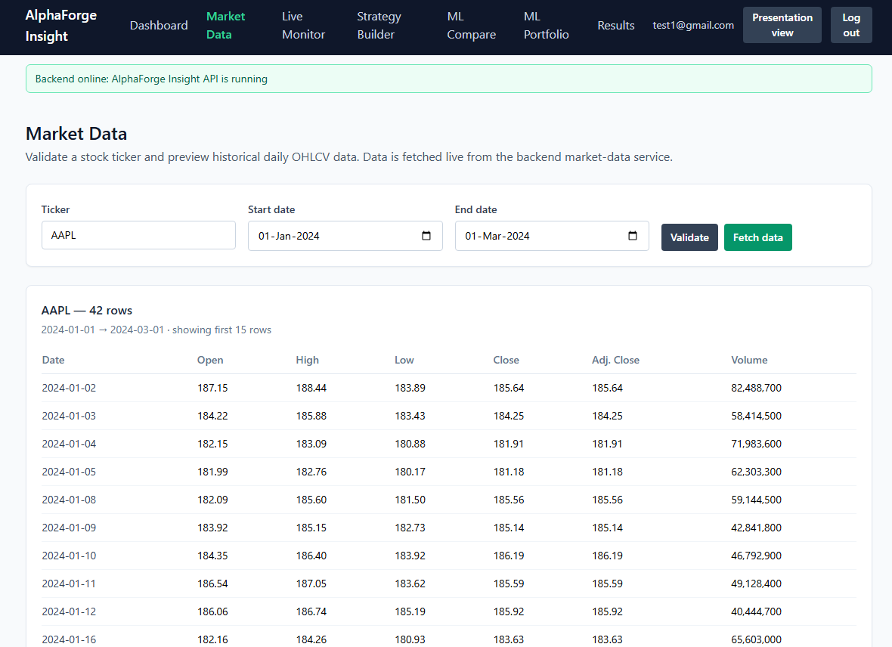
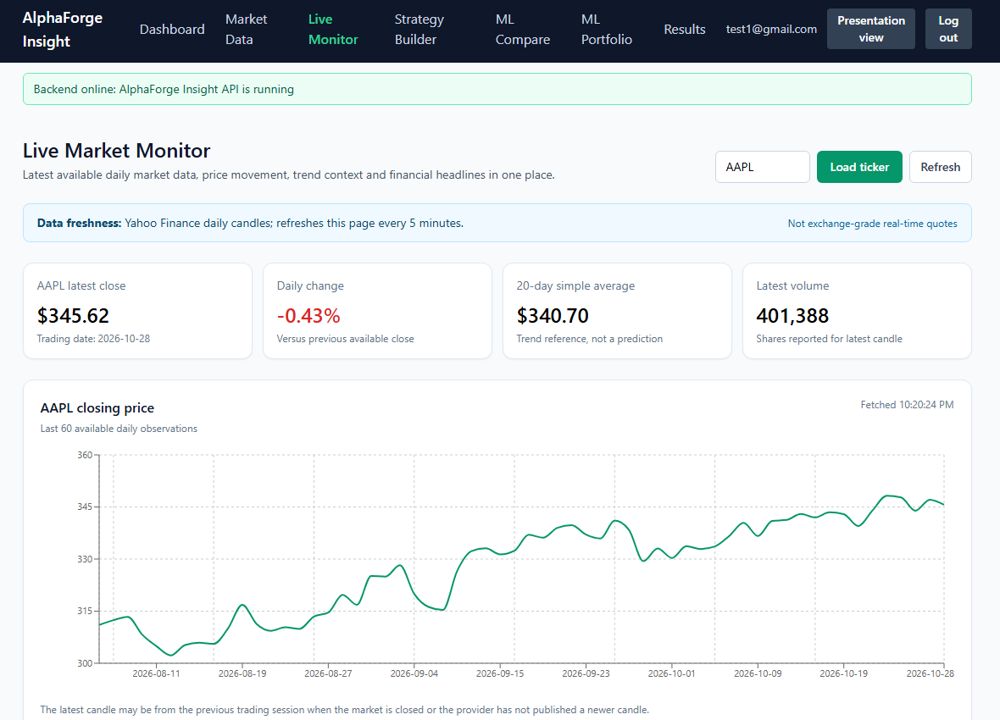
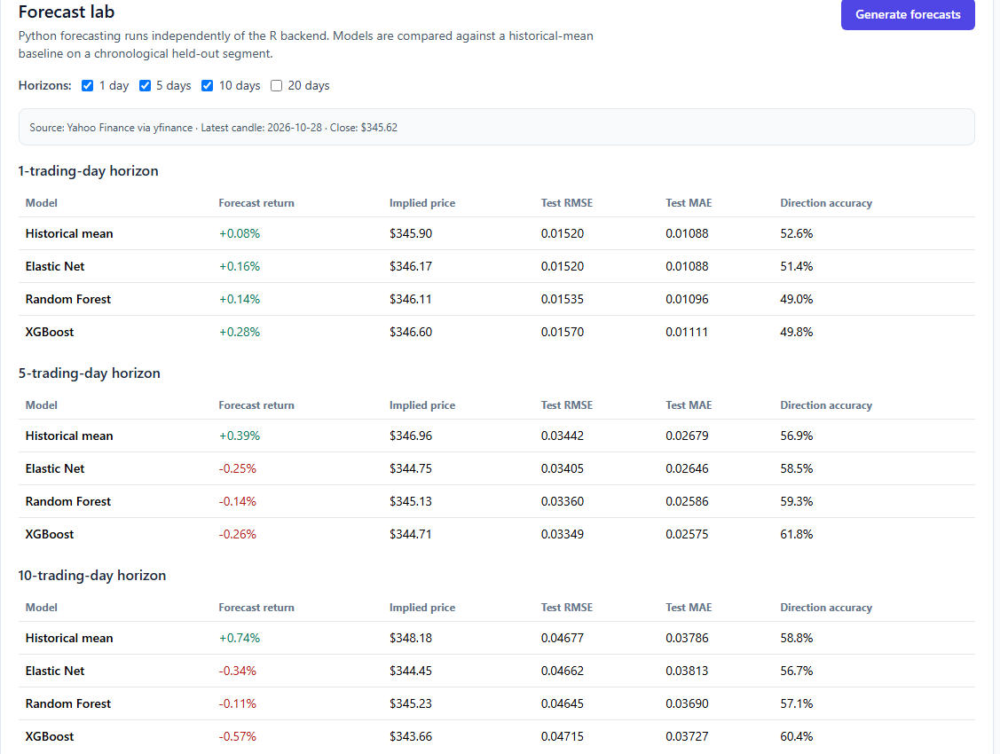
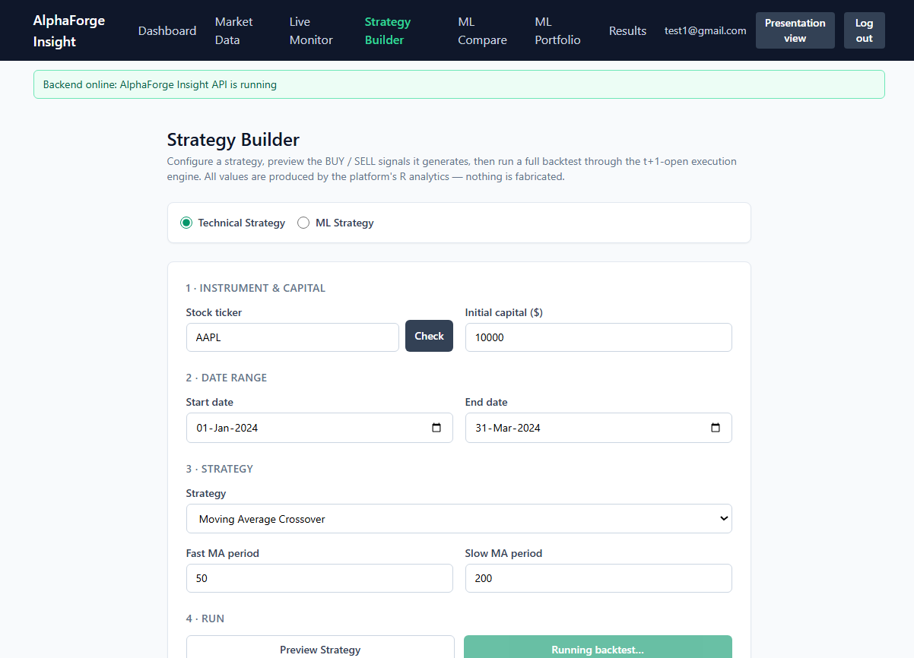
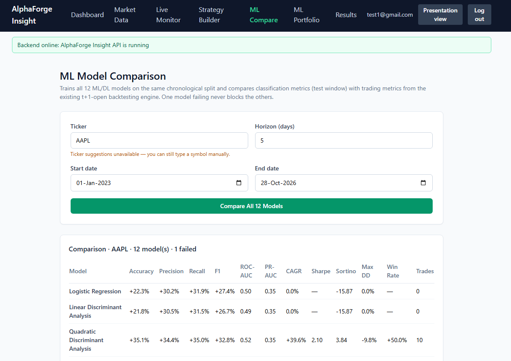
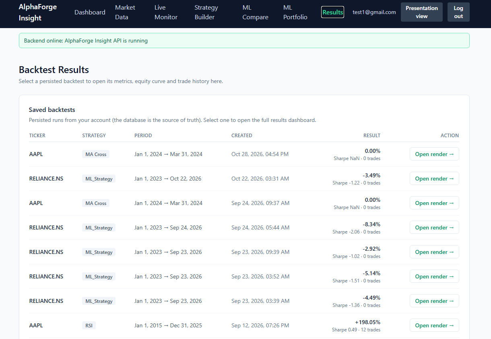
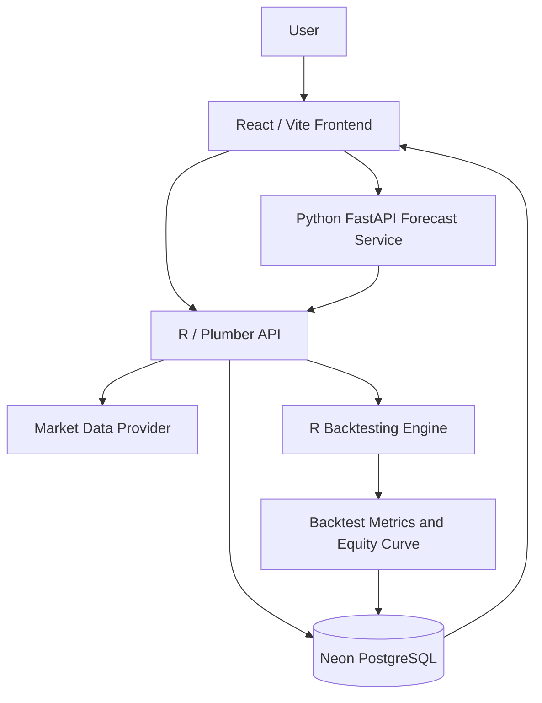

# AlphaForge Insight — Quant Strategy Backtester

**A web-based quantitative strategy backtesting and market-analysis platform.**

AlphaForge Insight brings historical market data, strategy configuration, backtesting, model comparison, forecasting experiments, and performance review into one workspace.

> **Disclaimer:** This project is for educational and research purposes only. Historical backtest results and model forecasts do not guarantee future performance and are not financial advice.

## Contents

- [Overview](#overview)
- [Key Features](#key-features)
- [Screenshots](#screenshots)
- [System Architecture](#system-architecture)
- [Technology Stack](#technology-stack)
- [Application Workflow](#application-workflow)
- [Running Locally](#running-locally)
- [Environment Variables](#environment-variables)
- [Interpreting Results Responsibly](#interpreting-results-responsibly)
- [Known Limitations](#known-limitations)
- [Future Improvements](#future-improvements)
- [Team](#team)

## Overview

Quantitative trading ideas can be difficult to evaluate consistently when market data, strategy parameters, model outputs, and performance metrics live in separate tools. AlphaForge Insight provides a workflow for exploring market data, configuring a strategy, running historical tests, and inspecting the resulting performance.

## Key Features

- **Dashboard and Backtest History** — Review saved backtests and open results for further inspection.
- **Market Data** — Validate a ticker, select a date range, and preview historical OHLCV data.
- **Live Market Monitor** — View the latest available daily price observations, daily change, volume, trend context, and market headlines.
- **Strategy Builder** — Configure technical strategies such as Moving Average Crossover and RSI, preview signals, and run a backtest.
- **Backtesting and Analytics** — Inspect returns, equity curves, trade history, and available measures such as Sharpe ratio, Sortino ratio, maximum drawdown, and win rate.
- **Forecast Lab** — Compare forecast outputs from a historical-mean baseline, Elastic Net, Random Forest, and XGBoost across selected trading-day horizons.
- **ML Model Comparison** — Compare selected model metrics and associated backtest statistics over a common ticker, date range, and forecast horizon.
- **Persistent Results** — Save and revisit backtest runs through the database-backed results workflow.
- **Presentation View** — Provide a simplified view of the application for project demonstrations.

## Screenshots

Screenshots are included in [`docs/screenshots/`](docs/screenshots/), so they render directly on GitHub.

### System Architecture



### Dashboard



### Dashboard Feature Cards and Recent News



### Market Data



### Live Market Monitor



### Forecast Lab



### Strategy Builder



### ML Model Comparison



### Backtest Results



## System Architecture

The application separates the user interface, analytics/backtesting API, forecasting service, and persistent storage.



This is a high-level conceptual view of the main components. Actual service URLs and deployment configuration may vary by environment.

## Technology Stack

- **Frontend:** React, Vite, JavaScript
- **Analytics and API:** R, Plumber
- **Forecasting service:** Python, FastAPI
- **Database:** PostgreSQL hosted on Neon
- **Market data:** Yahoo Finance / `yfinance` and the configured backend market-data path
- **Backtesting:** Indicator-driven strategy signals, historical simulation, and performance analytics
- **Deployment:** Frontend and backend services can be deployed separately using environment variables

Check the repository's package manifests and dependency files for exact versions.

## Application Workflow

1. Select a ticker and date range.
2. Fetch or preview the available market data.
3. Configure a strategy and its parameters.
4. Preview generated signals when supported.
5. Run the historical backtest.
6. Inspect the equity curve, trades, and available performance metrics.
7. Save the run and revisit it through the results/history view.
8. Use Forecast Lab or ML Model Comparison to investigate model outputs separately from the rule-based strategy workflow.

## Running Locally

The exact commands depend on the scripts and dependency files in the repository.

### 1. Clone the repository

```bash
git clone <YOUR_REPOSITORY_URL>
cd <YOUR_REPOSITORY_DIRECTORY>
```

### 2. Frontend

```bash
cd frontend
npm install
npm run dev
```

Create a local `.env` file based on `.env.example` and configure the API URLs for your environment. For example:

```env
VITE_API_URL=http://127.0.0.1:8000
VITE_TS_API_URL=http://127.0.0.1:8001
```

For a deployed frontend, set these variables in the hosting provider's environment settings and rebuild/redeploy. Vite embeds `VITE_*` values into the client bundle at build time; **never place secrets in these variables**.

### 3. R / Plumber API

Start the R/Plumber service using the repository's configured entry point and scripts. The project configuration expects port `8000` for local use. Check the repository's R dependency files and API entry point for the exact command.

### 4. Python forecasting service

Install dependencies from the Python service's requirements file, then start FastAPI using the entry point defined in the repository. The project configuration expects port `8001` for local use.

For example, if the entry point is `service.py` and dependencies are installed:

```bash
uvicorn service:app --host 0.0.0.0 --port 8001
```

Run the command from the directory containing `service.py`, or adjust the module path to match the repository layout.

## Environment Variables

Set only the variables required by the services you deploy. Verify current source code and hosting settings before deployment.

| Variable | Purpose |
|---|---|
| `VITE_API_URL` | Base URL for the main application API |
| `VITE_TS_API_URL` | Base URL for the Python time-series forecasting service |
| `ALPHAFORGE_PYTHON_TS_HOST` | Host used by the R-side Python-service integration |
| `ALPHAFORGE_PYTHON_TS_PORT` | Port used by the R-side Python-service integration |
| `ALPHAFORGE_R_MARKET_DATA_URL` | Base URL of the R service's internal market-data endpoint, when shared market data is used |
| `ALPHAFORGE_INTERNAL_MARKET_DATA_TOKEN` | Shared token required for authenticated internal market-data requests |
| `PYTHON_MARKET_DATA_ALLOW_YFINANCE_FALLBACK` | Optional switch for the Python service's Yahoo Finance fallback, if enabled |

**Security:** Never commit real credentials, JWT secrets, database connection strings, or internal service tokens. Keep them in local environment files excluded from Git and in your hosting provider's secret/environment settings.

## Interpreting Results Responsibly

- High classification accuracy does not by itself demonstrate profitable trading.
- Forecast error metrics such as RMSE and MAE measure prediction error; return, Sharpe, Sortino, drawdown, and trade counts describe different aspects of a simulated trading strategy.
- A backtest with zero trades may report undefined metrics such as Sharpe ratio.
- Use chronological train/test splits and out-of-sample evaluation when assessing predictive models.
- Include transaction costs, slippage, and a benchmark when making stronger performance comparisons.
- A model that performs well on one historical period may not generalize to another.

## Known Limitations

- Market-data availability, freshness, and request limits depend on the upstream provider.
- Outputs vary by ticker, date range, strategy parameters, and model configuration.
- Forecasts and backtest metrics are experimental analytical outputs, not investment recommendations.
- Exact setup commands and dependencies should be checked against the repository's current scripts and dependency manifests.

## Future Improvements

- Add more rigorous out-of-sample and walk-forward validation.
- Expand transaction-cost and slippage modeling.
- Improve market-data caching, provider fallback, and error visibility.
- Add richer benchmark comparisons and portfolio-level risk analysis.
- Expand exportable reports and reproducibility controls for experiments.

## Team

**Project:** AlphaForge Insight — Quant Strategy Backtester  
**Team:** AlphaForge  
**Member:** Nipun Saxena (`24BDS1025`)  
**Institution:** VIT Chennai

## License

No license is specified here. Add a `LICENSE` file before describing the project as open source, and select a license suitable for your intended use.
